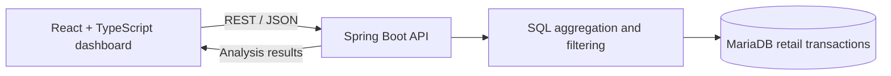

# E-Commerce Analytics Platform

**Full-stack retail analytics · REST APIs · SQL reporting · automated quality checks**

A collaborative analytics application that turns retail transactions into interactive views of revenue, product performance, and customer spending.

**Built with:** React · TypeScript · Spring Boot · Java · MariaDB · Docker Compose · GitLab CI/CD

## At a glance

| Analytics view | What it provides |
| --- | --- |
| **Revenue** | Trends and summaries of sales performance, with date-based filtering |
| **Products** | Product revenue analysis with configurable result limits |
| **Customers** | Customer spending comparisons and ranked results |
| **Dashboard** | A shared frontend for exploring the main analytics workflows |

## System architecture



- **Frontend:** React dashboard, reusable UI components, charts, and frontend tests.
- **Backend:** Java/Spring Boot API, request handling, SQL-backed analytics, and backend tests.
- **Database:** MariaDB transaction records initialized by the included database setup scripts.
- **Local development:** Docker Compose connects the frontend, backend, and database services.

## Engineering process

### Agile delivery and requirements

The team delivered the system over **eight Scrum sprints**, using backlog items, user stories, acceptance criteria, feature branches, merge requests, and retrospectives.

The accompanying GitLab project documentation covers REST endpoints, UML class and sequence diagrams, code standards, technical debt, and system acceptance testing.

### CI/CD

The committed [GitLab pipeline configuration](.gitlab-ci.yml) defines four automated checks:

| Pipeline job | Check |
| --- | --- |
| `frontend_lint` | ESLint checks for the frontend |
| `backend_checkstyle` | Gradle/Checkstyle for Java code |
| `frontend_tests` | Frontend tests with coverage output |
| `backend_tests_coverage` | Backend tests and JaCoCo coverage report |

The pipeline is configured for pushes and merge requests in **GitLab**. It does **not** automatically execute as GitHub Actions after mirroring the repository.

## Run locally

**Requirements:** Docker Desktop or Docker Engine with Docker Compose.

1. Copy the local configuration template:
   ```bash
   cp .env.example .env
   ```
2. Edit `.env` and set a unique `DB_PASSWORD` value. **Do not commit `.env`.**
3. Build and run the services:
   ```bash
   docker compose up --build
   ```
4. With all containers running, the frontend is configured for **http://localhost:3000** and the backend for **http://localhost:8080**.

Stop the services with `docker compose down`.

> **Local-development notes:** These Compose files are not production hardening. The database is exposed to the host for development. If you previously initialized a persistent MariaDB volume using an old password, updating `.env` alone will not rotate that database account's existing password; update it in the database or create a new **disposable development** volume only if you do not need its data.

## Repository structure

```text
frontend/             React UI, dashboard views, frontend tests
backend/              Spring Boot API, SQL-backed services, tests
database/             MariaDB image, initialization scripts and retail data
.gitlab-ci.yml        Automated lint and test pipeline
compose.yaml          Local multi-container development
compose.deploy.yaml   Alternate Compose configuration
.env.example          Example (non-secret) local environment settings
```

## Dataset and attribution

This repository includes a retail dataset named `online_retail_II.csv`. The corresponding **Online Retail II** dataset is published by the **UCI Machine Learning Repository** under **Creative Commons Attribution 4.0**.

**Dataset citation:** Chen, D. (2012). *Online Retail II* [Dataset]. UCI Machine Learning Repository. https://doi.org/10.24432/C5CG6D

- [UCI Online Retail II dataset](https://archive.ics.uci.edu/dataset/502/online+retail+ii)
- [CC BY 4.0 license](https://creativecommons.org/licenses/by/4.0/)

If the included CSV was exported, filtered, or transformed from the source workbook, those transformations are part of this project's data preparation; the original dataset and its license remain attributable to the source creator. This attribution does not grant rights to unrelated third-party materials.

## Contributions

This is a **team-built software engineering project**, with original authors and commit history retained.

**My contributions** included extensive work troubleshooting **GitLab CI/CD** lint/test checks across frontend and backend components, validating changes during the merge process, and participating in Scrum delivery and supporting technical documentation.

The dashboards and architecture represent the overall team's implementation—not a claim of sole authorship.

## Further improvements

- Add verified screenshots of each dashboard.
- Expand API examples and setup troubleshooting.
- Record automated test coverage and CI outcomes with evidence.
- Improve production deployment security, including least-privilege database access.

---

*Project presented as a technical portfolio example. Credit to the full development team.*
