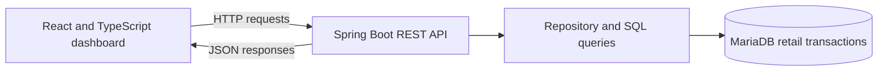

# E-Commerce Analytics Platform

A full-stack retail analytics application for exploring sales performance, customer spending, and product trends. It combines a React dashboard with a Spring Boot REST API and a MariaDB data store.

**Stack:** React · TypeScript · Java · Spring Boot · MariaDB · SQL · Docker Compose · GitLab CI/CD

> **Project status:** Collaborative software engineering project. This repository includes the team's work and original Git history. The contribution notes below distinguish individual work from the overall implementation.

## What it does

| Area | Capabilities |
| --- | --- |
| **Revenue analytics** | View revenue trends over time, including monthly summaries and date-range filtering. |
| **Product analytics** | Explore top-performing products by revenue and adjust the number of results shown. |
| **Customer analytics** | Compare customer spending and adjust the number of ranked customers displayed. |
| **Dashboard overview** | See important analytics at a glance rather than switching between reports. |

The application is designed around product-analyst workflows: retrieving data from REST endpoints, transforming results for charts, and providing clear feedback when a request cannot be completed.

## Architecture



The backend exposes endpoints used by the dashboard's revenue, product, and customer views. Data is aggregated and filtered in SQL before being returned to the frontend.

## Engineering highlights

### Agile delivery and requirements

The team organized delivery across **eight Scrum sprints**, tracking product-backlog items, user stories, tasks, acceptance criteria, sprint reviews, and retrospectives in GitLab. The project documentation also includes UML class/sequence diagrams, API contracts, technical-debt analysis, and system acceptance testing.

### CI/CD and automated quality checks

GitLab pipelines run on pushes and merge-request events. The versioned [`.gitlab-ci.yml`](.gitlab-ci.yml) defines four jobs:

| Job | Purpose |
| --- | --- |
| `frontend_lint` | Runs frontend ESLint checks. |
| `backend_checkstyle` | Runs Java Checkstyle checks with Gradle. |
| `frontend_tests` | Runs frontend tests with coverage reporting. |
| `backend_tests_coverage` | Runs backend tests and generates JaCoCo coverage reports. |

These are **GitLab CI/CD** workflows; copying the source to GitHub does not automatically convert them to GitHub Actions.

### Design and quality

- Documented REST endpoint behavior and frontend/backend interactions with UML diagrams.
- Refined hard-coded API result limits by adding optional filtering parameters.
- Documented technical debt and performed system acceptance testing.
- Used feature branches, merge requests, and code review to integrate changes.

## My contribution

I worked extensively with the **GitLab CI/CD pipelines**, including investigating automated frontend/backend lint and test failures and validating changes during the merge process. I also participated in the Scrum delivery workflow and related technical documentation.

The analytics application was **developed collaboratively**. Features and technical decisions described above represent the team's work; the Git commit history preserves individual authorship.

## Project structure

```text
frontend/            React UI, charts, frontend tests
backend/             Spring Boot API, repositories, backend tests
database/            MariaDB initialization and dataset import
.gitlab-ci.yml       GitLab pipeline configuration
compose.yaml         Local Docker Compose services
compose.deploy.yaml  Deployment-oriented Compose configuration
```

## Screenshots and technical documentation

Screenshots of the dashboards, selected UML diagrams, and a focused CI/CD walkthrough can be added here after they are reviewed for publication.

## Notes for reviewers

- The project was built as a **team**; it should not be interpreted as solely authored by the account owner.
- The committed Compose configuration is a **development example**, not a production deployment specification. Do not deploy it to a public server with the example database credentials.
- Dataset redistribution rights, sharing permissions, and repository history should be reviewed **before making the repository public**.

## Acknowledgments

Thanks to the original development team. Attribution remains available in the commit history.
